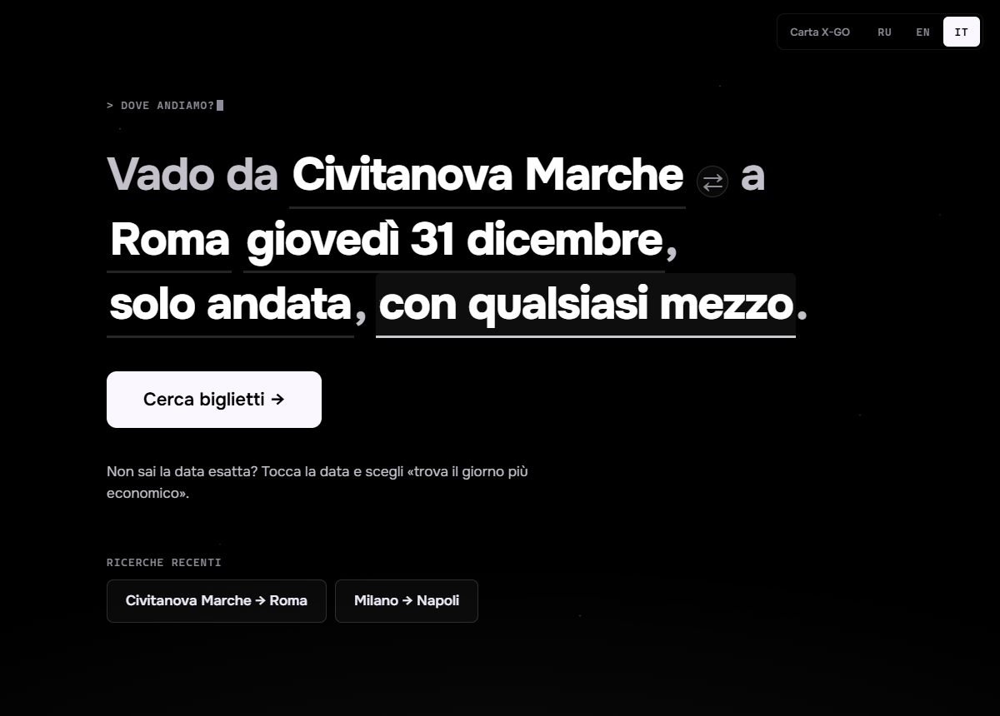
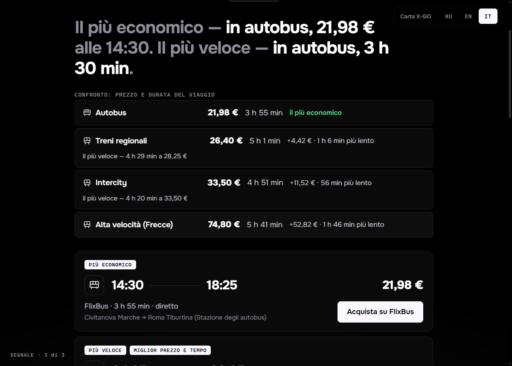
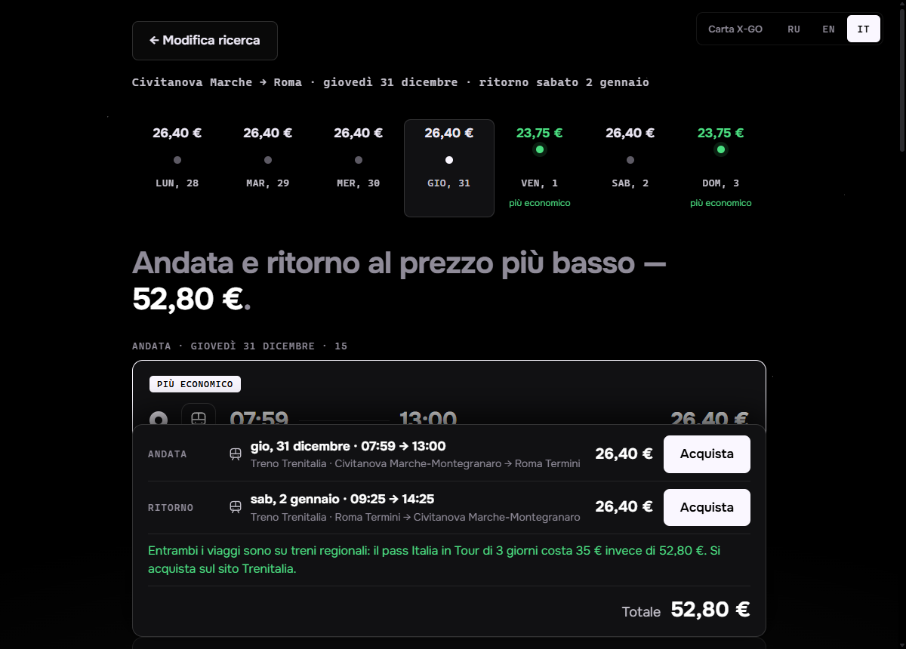
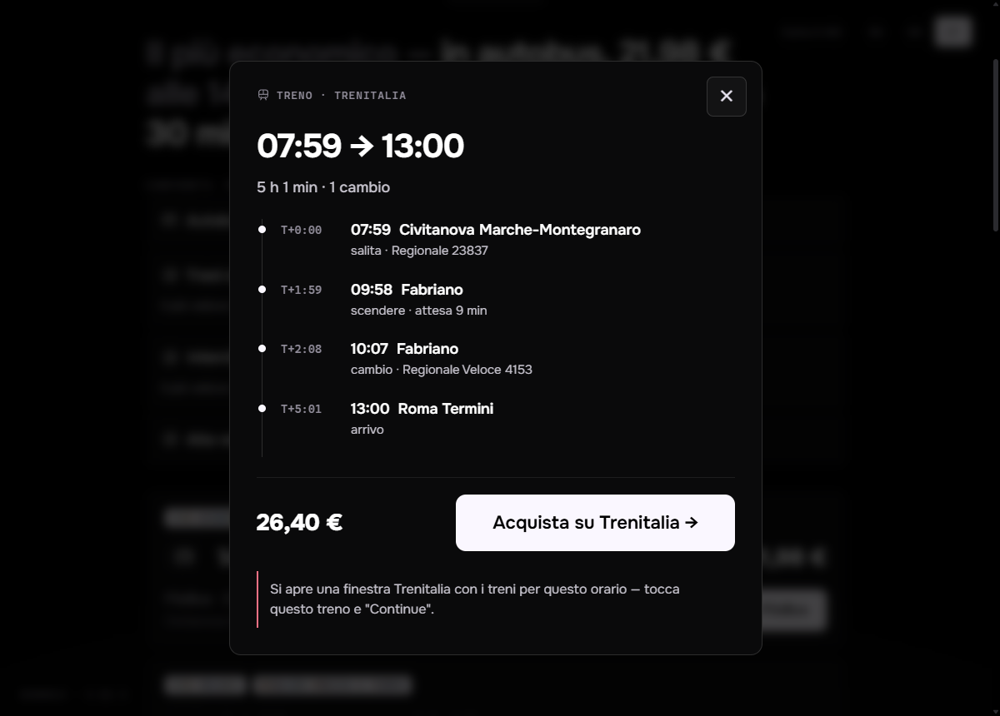

# TSM — treni, autobus e voli in Italia

[English](README.md) · [Русский](README.ru.md) · **Italiano**

Un'app desktop (Windows e macOS) che trova il modo più economico per andare da una città italiana a
un'altra. Scrivi una frase — *"Vado da Civitanova Marche a Roma dal 20 al 31 dicembre, ritorno dal 2 al
10 gennaio"* — e l'app interroga subito Trenitalia, FlixBus e Ryanair, controlla ogni giorno, sceglie il
più economico e ti porta sul sito del vettore per comprare il biglietto.

È pensata per chi non è pratico di computer: una schermata, testo grande, nessuna impostazione.
L'interfaccia è in **italiano, inglese e russo** (si cambia in alto a destra).



## Download

Un solo file, niente da installare — da [Releases](../../releases/latest):

| Sistema | File |
|---|---|
| Windows 10 / 11 | **`TSM.exe`** — scarica e apri con doppio clic |
| macOS (Apple Silicon e Intel) | **`TSM.dmg`** — apri e trascina TSM in Applicazioni |

L'app non è firmata digitalmente, quindi al primo avvio serve un clic in più:
- **Windows** — "Windows ha protetto il PC" → *Ulteriori informazioni* → *Esegui comunque*.
- **macOS** — "non può essere aperta perché lo sviluppatore non è identificato" → clic destro su TSM →
  *Apri* → *Apri*.

## Cosa fa

- **Ricerca con una frase.** Ogni parola evidenziata è un pulsante: da, a, quando, ritorno, mezzo.
- **Qualsiasi città d'Italia.** Le città si cercano direttamente negli elenchi di Trenitalia e FlixBus,
  quindi si trovano anche i paesi piccoli.
- **Treno, autobus, aereo o tutto insieme.** Trenitalia (Frecciarossa, Intercity, regionali),
  FlixBus / FlixTrain, Ryanair. Gli aeroporti più vicini vengono scelti in automatico in base alla distanza.
- **Non sai la data — "trova il giorno più economico".** Tocca la data → *Non so*: *prossima settimana*,
  *prossime 2 settimane*, *tutto dicembre* o qualsiasi periodo *dal … al …* (fino a 31 giorni) per andata e
  ritorno: l'app controlla ogni giorno e seleziona il più economico.
- **Confronto per prezzo e durata.** Una riga per ogni mezzo — treni regionali, Intercity, Frecce, autobus,
  aereo — con il prezzo più basso, la durata e quanto costa in più e quanto è più veloce rispetto alla
  soluzione più economica.
- **Pass Italia in Tour.** Il pass Trenitalia illimitato sui regionali: 35 € per 3 giorni (59 € per 5).
  Se i biglietti regionali costano di più, l'app lo segnala — anche per andata e ritorno entro 3 o 5 giorni.
- **Carta X-GO / CartaFreccia.** Inserisci il numero della carta (in alto a destra) e Trenitalia mostra i
  prezzi per i soci, nei risultati e nella finestra d'acquisto. Il numero resta sul computer e va solo a Trenitalia.
- **Anche viaggi solo regionali.** Le "soluzioni principali" di Trenitalia nascondono alcuni viaggi solo
  regionali: l'app li chiede a parte, e spesso sono i più economici.
- **Prezzi per giorno.** Una linea con i prezzi dei giorni vicini alla data scelta; il più economico è
  evidenziato.
- **Andata e ritorno.** Due liste, le soluzioni più economiche già selezionate, e la barra del totale dice
  esattamente a cosa si riferisce ogni prezzo: giorno, orari, mezzo, vettore.
- **Etichette invece dell'ordinamento.** *Più economico*, *Più veloce*, *Miglior prezzo e tempo*.
- **Diario del viaggio.** Cambi e attese spiegati semplicemente.
- **Acquisto.** Ryanair e FlixBus si aprono direttamente sui risultati per il tuo percorso e giorno.
  Trenitalia non ha link di questo tipo, quindi l'app apre Trenitalia in una sua finestra con i treni per
  il tuo percorso e orario già caricati: scegli il treno e premi *Continue*.
- **I treni esauriti sono nascosti** (Trenitalia li restituisce con un prezzo).

| Confronto | Andata e ritorno e pass Italia in Tour |
|---|---|
|  |  |

| Diario del viaggio | Finestra Trenitalia |
|---|---|
|  |  |

## Come funziona

Non c'è un server. L'app parla direttamente con le stesse API interne usate dai siti dei vettori:

| Vettore | Indirizzo |
|---|---|
| Trenitalia | `POST lefrecce.it/Channels.Website.BFF.WEB/website/ticket/solutions` |
| FlixBus | `GET global.api.flixbus.com/search/service/v4/search` |
| Ryanair | `GET ryanair.com/api/farfnd/v4/oneWayFares/{da}/{a}/cheapestPerDay` |

Queste API sono **non ufficiali e non documentate** e possono cambiare in qualsiasi momento. Se qualcosa
smette di funzionare, `npm run live` mostra quale vettore si è rotto. Italo non è supportato: non esiste
un modo pubblico per ottenere i suoi prezzi.

Le risposte restano in cache per 2 ore. I giorni di un periodo vengono richiesti uno alla volta per non
sommergere i vettori di richieste: un mese richiede circa un minuto.

## Compilare dai sorgenti

Servono Node.js 20+, Rust (stable) e, su Windows, Visual Studio Build Tools con C++.
Vedi i [requisiti di Tauri](https://v2.tauri.app/start/prerequisites/).

```bash
npm install
npm run dev                      # nel browser su http://localhost:1420 (un proxy Vite aggira il CORS)
npm run tauri dev                # come finestra desktop
npm run tauri build -- --no-bundle   # solo l'app: src-tauri/target/release/tsm.exe
npm test                         # test sulle risposte reali salvate
npm run live                     # verifica dal vivo di tutti i vettori
```

Le release le compila GitHub Actions: invia un tag come `v0.3.0` e `TSM.exe` + `TSM.dmg` compaiono in una
nuova release.

## Struttura

```
src/
  core/        ricerca, etichette, calendario prezzi, cache, elenco città, ricerca città, acquisto
  providers/   trenitalia.ts, flixbus.ts, ryanair.ts — un file per vettore, stessa interfaccia
  ui/          schermate; i18n.ts contiene tutti i testi in italiano, inglese e russo
src-tauri/     guscio desktop (Rust); trenitalia.js — lo script della finestra Trenitalia
tests/         Vitest; le fixture sono risposte reali dei vettori
```

## Avvertenza

È un progetto personale, non affiliato a Trenitalia, FlixBus o Ryanair. Legge solo i risultati pubblici
delle ricerche e ti manda sui siti dei vettori per comprare i biglietti. I prezzi sono quelli restituiti
dai vettori al momento della ricerca; il prezzo finale è sempre quello sul sito del vettore.

Il font [Onest](https://fonts.google.com/specimen/Onest) è distribuito con licenza SIL Open Font License
(`public/fonts/Onest-OFL.txt`).
