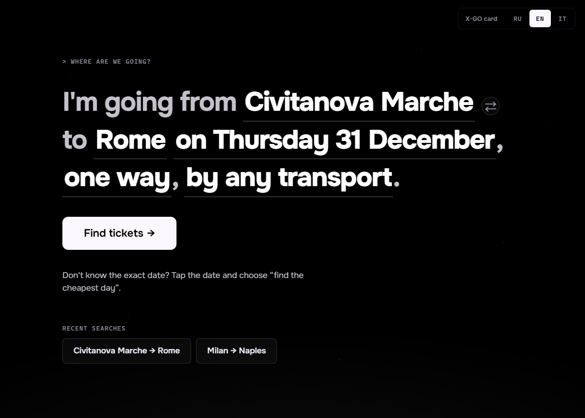
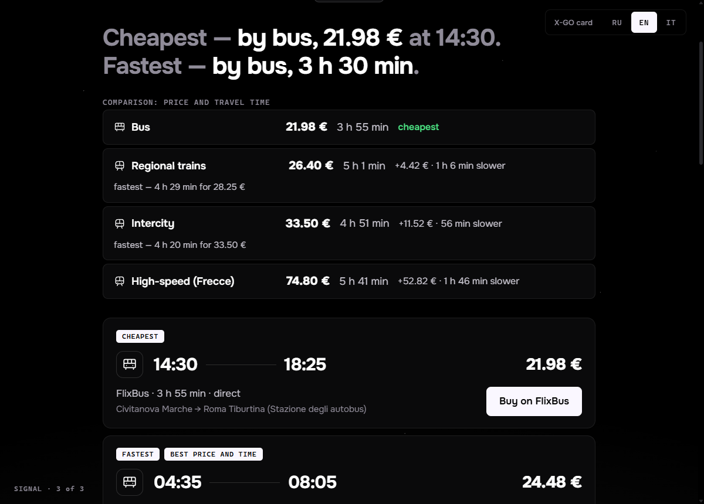
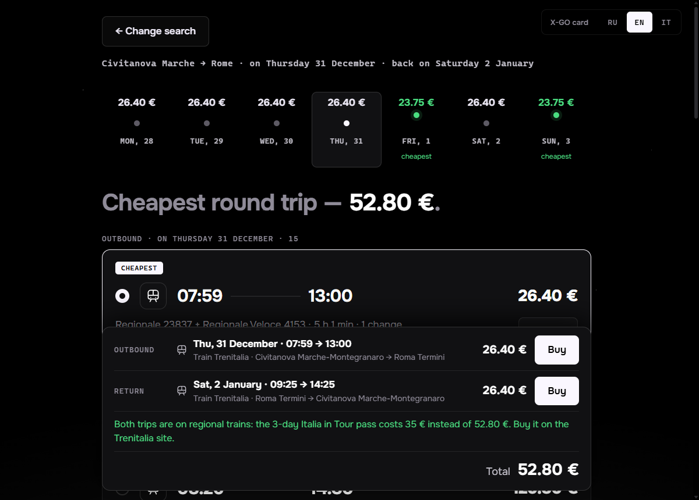
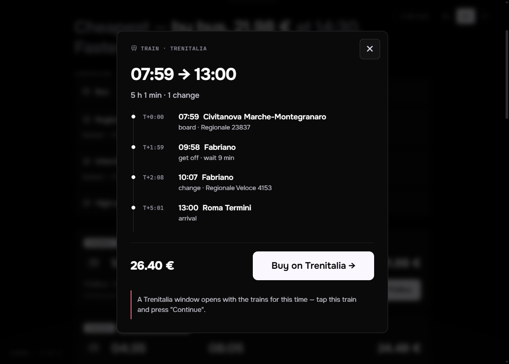
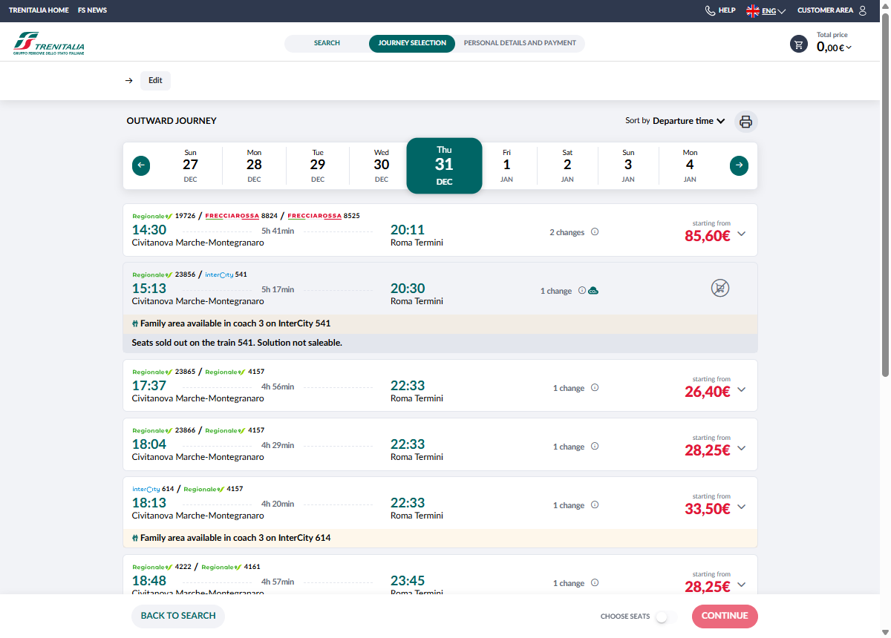

# TSM — trains, buses and flights across Italy

**English** · [Русский](README.ru.md) · [Italiano](README.it.md)

A desktop app (Windows and macOS) that finds the cheapest way to get from one Italian town to another.
You type one sentence — *"I'm going from Civitanova Marche to Rome from 20 to 31 December, back from 2 to
10 January"* — and it asks Trenitalia, FlixBus and Ryanair at once, checks every day, picks the cheapest
and takes you to the carrier's site to buy the ticket.

It was built for people who are not comfortable with computers: one screen, big text, no settings.
The interface is in **English, Russian and Italian** (switch in the top-right corner).



## Download

One file, nothing to install — get it from [Releases](../../releases/latest):

| System | File |
|---|---|
| Windows 10 / 11 | **`TSM.exe`** — download and double-click |
| macOS (Apple Silicon and Intel) | **`TSM.dmg`** — open and drag TSM to Applications |

The app is not code-signed, so the first launch needs one extra click:
- **Windows** — "Windows protected your PC" → *More info* → *Run anyway*.
- **macOS** — "can't be opened because it is from an unidentified developer" → right-click TSM → *Open* → *Open*.

## Features

- **Search as a sentence.** Every highlighted word is a button: from, to, when, back, transport.
- **Any town in Italy.** Towns are looked up live in the Trenitalia and FlixBus directories, so small
  places work too. Typing in Russian is fine — *«Чивитанова»* finds *Civitanova Marche*.
- **Trains, buses, flights or everything.** Trenitalia (Frecciarossa, Intercity, regional trains),
  FlixBus / FlixTrain, Ryanair. The nearest airports are picked automatically by distance.
- **Not sure of the date — "find the cheapest day".** Tap the date → *Not sure*: pick *next week*,
  *next 2 weeks*, *all of December* or any *from … to …* range (up to 31 days) for the outbound and the
  return trip; the app checks every day and selects the cheapest one.
- **Comparison by price and travel time.** One line per kind of transport — regional trains, Intercity,
  high-speed Frecce, bus, plane — with its lowest price, travel time and how much more it costs and how
  much faster it is than the cheapest option.
- **Italia in Tour pass.** Trenitalia's 35 € / 3 days (59 € / 5 days) unlimited regional-train pass: when
  your regional tickets cost more, the app says so — also for round trips within 3 or 5 days.
- **X-GO / CartaFreccia card.** Enter your card number (top-right) and Trenitalia returns member prices,
  in the results and in the buying window. The number stays on your computer and goes only to Trenitalia.
- **All-regional journeys too.** Trenitalia's "main solutions" hide some regional-only journeys; the app
  asks for them separately — they are often the cheapest.
- **Prices by day.** A price line for the days around your date; the cheapest day is highlighted.
- **Round trips.** Two lists, the cheapest options are preselected, and the total bar says exactly what
  each price is for: day, times, transport, carrier.
- **Labels instead of sorting.** *Cheapest*, *Fastest*, *Best price and time*.
- **Trip log.** Every change and wait in plain words.
- **Buying.** Ryanair and FlixBus open the results page for your route and day. Trenitalia has no such
  links, so the app opens Trenitalia in its own window with the trains for your route and time already
  loaded — pick the train and press *Continue*.
- **Sold-out trains are hidden** (Trenitalia reports them with a price).

| Comparison | Round trip and the Italia in Tour pass |
|---|---|
|  |  |

| Trip log | Trenitalia window |
|---|---|
|  |  |

## How it works

There is no server. The app talks directly to the same internal web APIs the carriers' own websites use:

| Carrier | Endpoint |
|---|---|
| Trenitalia | `POST lefrecce.it/Channels.Website.BFF.WEB/website/ticket/solutions` |
| FlixBus | `GET global.api.flixbus.com/search/service/v4/search` |
| Ryanair | `GET ryanair.com/api/farfnd/v4/oneWayFares/{from}/{to}/cheapestPerDay` |

These APIs are **unofficial and undocumented** and can change at any time. When something stops being
found, run `npm run live` — it shows which carrier broke. Italo is not supported: there is no public way
to get its prices.

Answers are cached for 2 hours. Days of a date range are fetched one by one so the carriers don't see a
burst of requests — a month takes about a minute.

## Build from source

Requirements: Node.js 20+, Rust (stable); on Windows also Visual Studio Build Tools with C++.
See the [Tauri prerequisites](https://v2.tauri.app/start/prerequisites/).

```bash
npm install
npm run dev                      # in the browser at http://localhost:1420 (a Vite proxy bypasses CORS)
npm run tauri dev                # as a desktop window
npm run tauri build -- --no-bundle   # just the app: src-tauri/target/release/tsm.exe
npm test                         # unit tests on saved real API answers
npm run live                     # live check of every carrier
```

Releases are built by GitHub Actions: push a tag like `v0.3.0` and `TSM.exe` + `TSM.dmg` appear in a new
release.

## Project structure

```
src/
  core/        search, labels, price calendar, cache, city directory, live town search, buying
  providers/   trenitalia.ts, flixbus.ts, ryanair.ts — one file per carrier, same interface
  ui/          screens; i18n.ts holds every text in English, Russian and Italian
src-tauri/     desktop shell (Rust); trenitalia.js — the Trenitalia window script
tests/         Vitest; fixtures are real carrier answers
```

## Disclaimer

This is a personal project, not affiliated with Trenitalia, FlixBus or Ryanair. It only reads public search
results and sends you to the carriers' own websites to buy tickets. Prices are those returned by the
carriers at search time; the final price is always the one on the carrier's site.

The [Onest](https://fonts.google.com/specimen/Onest) font is distributed under the SIL Open Font License
(`public/fonts/Onest-OFL.txt`).
