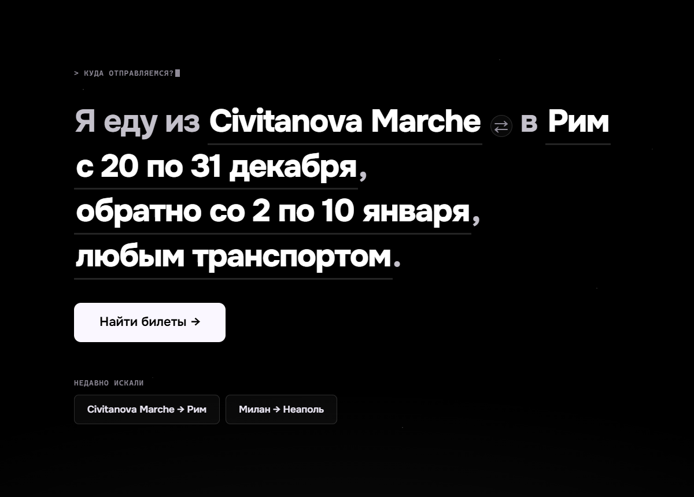
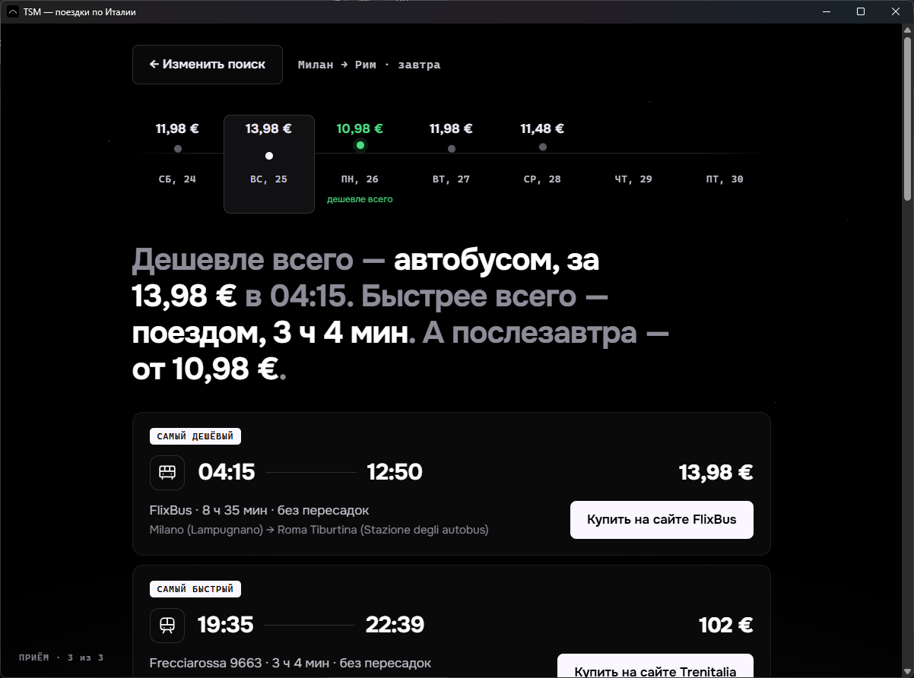
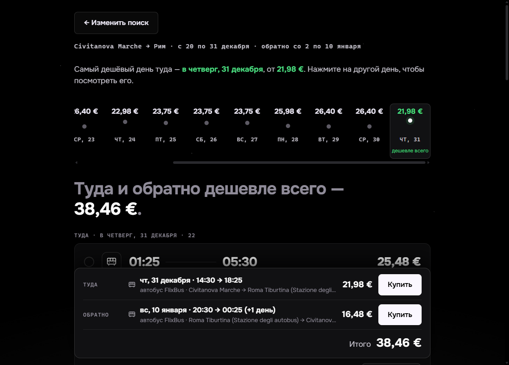

# TSM — trains, buses and flights across Italy

**English** · [Русский](README.ru.md)

A desktop app (Windows and macOS) that finds the cheapest way to get from one Italian town to another.
You type one sentence — *"I'm going from Civitanova Marche to Rome on 31 December, back on 5 January"* —
and it asks Trenitalia, FlixBus and Ryanair at once, shows prices day by day and takes you to the
carrier's site to buy the ticket.

It was built for people who are not comfortable with computers: one screen, big text, no settings.
The interface is in Russian.



## Features

- **Search as a sentence.** Every highlighted word is a button: from, to, when, back, transport.
- **Any town in Italy.** Cities are looked up live in the Trenitalia and FlixBus directories,
  so small towns work too. Typing in Russian is fine — *«Чивитанова»* finds *Civitanova Marche*.
- **Trains, buses, flights or everything.** Trenitalia (Frecciarossa, Intercity, regional trains),
  FlixBus / FlixTrain, Ryanair. The nearest airports are picked automatically by distance.
- **Prices by day.** A price line for the week around your date; the cheapest day is highlighted.
- **Date range — "find me the cheapest".** Pick *from … to …* (up to 31 days) for the outbound and
  the return trip; the app checks every day and selects the cheapest one.
- **Round trips.** Two lists, the cheapest ones are preselected, and a total bar says exactly what
  each price is for: day, times, transport, carrier.
- **Labels instead of sorting.** *Cheapest*, *Fastest*, *Best price/time*.
- **Trip log.** Every change, wait and platform step in plain words.
- **Buying.**
  - Ryanair and FlixBus open the results page for your route and day.
  - Trenitalia has no such links, so the app opens Trenitalia in its own window with the list of
    trains for your route and time already loaded — pick the train and press *Continue*.
- **Sold-out trains are hidden** (Trenitalia reports them with a price).

| Results | Round trip | Trenitalia window |
|---|---|---|
|  |  |  |

## Download

Get the latest version from [Releases](../../releases). Each platform is a single file:

| Platform | File |
|---|---|
| Windows 10/11 — installer | `TSM_x.y.z_x64-setup.exe` |
| Windows 10/11 — no install | `TSM-portable.exe` |
| macOS (Apple Silicon and Intel) | `TSM_x.y.z_universal.dmg` |

The app is not code-signed:
- **Windows** shows "Windows protected your PC" once → *More info* → *Run anyway*.
- **macOS** says the app can't be checked → right-click the app → *Open* → *Open*.

The portable `.exe` needs Microsoft Edge WebView2, which is already part of Windows 10/11.

## How it works

There is no server. The app talks directly to the same internal web APIs the carriers' own websites use:

| Carrier | Endpoint |
|---|---|
| Trenitalia | `POST lefrecce.it/Channels.Website.BFF.WEB/website/ticket/solutions` |
| FlixBus | `GET global.api.flixbus.com/search/service/v4/search` |
| Ryanair | `GET ryanair.com/api/farfnd/v4/oneWayFares/{from}/{to}/cheapestPerDay` |

These APIs are **unofficial and undocumented** and can change at any time. When something stops being
found, run `npm run live` — it shows which carrier broke. Italo is not supported: there is no public
way to get its prices.

Answers are cached for 2 hours. Days of a price range are fetched one by one so the carriers don't
see a burst of requests.

## Build from source

Requirements: Node.js 20+, Rust (stable), and for Windows the Visual Studio Build Tools with C++.
See the [Tauri prerequisites](https://v2.tauri.app/start/prerequisites/).

```bash
npm install
npm run dev          # in the browser at http://localhost:1420 (a Vite proxy bypasses CORS)
npm run tauri dev    # as a desktop window
npm run tauri build  # installers in src-tauri/target/release/bundle/
npm test             # unit tests on saved real API answers
npm run live         # live check of every carrier
```

macOS builds run on GitHub Actions: push a tag `v*` (or start the *build* workflow by hand) and the
files appear in a draft release.

## Project structure

```
src/
  core/        search, labels, price calendar, cache, city directory, live city search, buying
  providers/   trenitalia.ts, flixbus.ts, ryanair.ts — one file per carrier, same interface
  ui/          screens: search sentence, results, round trip, calendar, trip log
src-tauri/     desktop shell (Rust); trenitalia.js — the Trenitalia window script
tests/         Vitest; fixtures are real carrier answers
```

## Disclaimer

This is a personal project, not affiliated with Trenitalia, FlixBus or Ryanair. It only reads public
search results and sends you to the carriers' own websites to buy tickets. Prices shown are those
returned by the carriers at search time; the final price is always the one on the carrier's site.

The [Onest](https://fonts.google.com/specimen/Onest) font is distributed under the SIL Open Font
License (`public/fonts/Onest-OFL.txt`).
